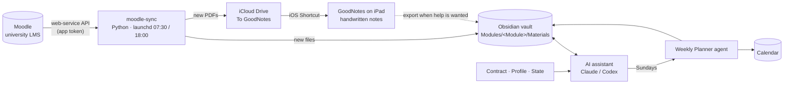

# mindAssistant

**A personal AI study assistant built on Obsidian and Claude, with an automated pipeline that brings course materials from the university's Moodle to my notes and my iPad.**

I'm a Computer Science student at Frankfurt University of Applied Sciences. My study material was scattered: slides on Moodle, notes in Obsidian, handwriting in GoodNotes, deadlines in my calendar. Every week I downloaded files by hand, and every AI chat started from zero. mindAssistant fixes both: course files arrive by themselves, and the assistant remembers what I've studied, where I struggle, and what's due.

<!-- Add a demo GIF here: docs/screenshots/demo.gif -->

## What it does

- **Remembers.** The assistant's memory is my Obsidian vault: plain Markdown notes it reads, searches and writes. A working contract defines what it saves (decisions, weak topics, deadlines, study results) and what it doesn't (small talk, one-off answers).
- **Plans.** A *Weekly Planner* agent runs every Sunday evening. It reads my calendar, routine, deadlines and recent notes, and writes a day-by-day study plan with a concrete task for each slot.
- **Teaches.** Study sessions are quizzes and explanations based on my own course files and saved weak topics, so the next session picks up where the last one ended.
- **Syncs.** A Python script pulls new files from Moodle twice a day into the right module folder and passes new PDFs on to GoodNotes on the iPad.

## Architecture

| Part | What it is | Where |
|---|---|---|
| Memory | Obsidian vault, module-first folders | [`vault-template/`](vault-template/) |
| Rules | Working contract: onboarding, what to save, boundaries | [`Contract.md`](vault-template/mindAssistant/Contract.md) |
| Agent | Weekly Planner with lane, inputs, rules, trust stages | [`Weekly Planner.md`](vault-template/mindAssistant/Agents/Weekly%20Planner.md) |
| Automation | Moodle → vault → GoodNotes sync | [`moodle-sync/`](moodle-sync/) |

## Design decisions

- **Files over databases.** Memory is plain Markdown, so it works with any assistant (Claude and Codex share it through `AGENTS.md`), syncs like any folder, and stays readable without AI.
- **AI where judgement is needed, scripts where it isn't.** Planning a week needs reasoning, so it's an AI agent. Downloading files is deterministic, so it's a scheduled script that costs nothing and runs even when no assistant is open.
- **Trust stages for agents.** The planner starts as *suggest only* (writes a note). Only after it proved useful did it get permission to create calendar events, and only events it owns.
- **Security.** The Moodle token is never stored in the vault, git or a cloud folder. The sync is read-only, and the token reaches only courses I'm enrolled in. Single sign-on works because the script uses the same handoff as the official Moodle app.
- **Don't fight GoodNotes.** It has no API, so the sync stops at an iCloud folder and an iOS Shortcut imports with one tap. Only new files are sent, so annotated documents are never duplicated.

## Try it

1. Copy `vault-template/` somewhere and open it as an Obsidian vault.
2. Open it with Claude (or Codex) and say **"Start my mindAssistant"**. It runs the onboarding interview and fills in `Profile.md`.
3. Set up the Moodle sync: see [`moodle-sync/README.md`](moodle-sync/README.md).

## Built with

Python (standard library only) · Moodle Web Services API · macOS launchd · iOS Shortcuts · Obsidian · Claude (incl. scheduled tasks and Google Calendar connector) · Codex · git

## Shoutout to mindsquare 💡

The core idea behind mindAssistant comes from [mindsquare](https://mindsquare.de). Alex Troost's webinar *"Dein zweites Gehirn: Mit 7 Tipps zum eigenen KI-Assistenten fürs Studium"* showed how Obsidian and an AI assistant can become a second brain for studying. The working contract in this repo is adapted from that guide. Everything around it (the agents, the Moodle pipeline, the GoodNotes workflow) grew from there. Thank you for the inspiration!

## Credits

I designed and run the system; much of it was built in pair-programming sessions with Claude.

## License

MIT, see [LICENSE](LICENSE). The contract adaptation is credited above.
