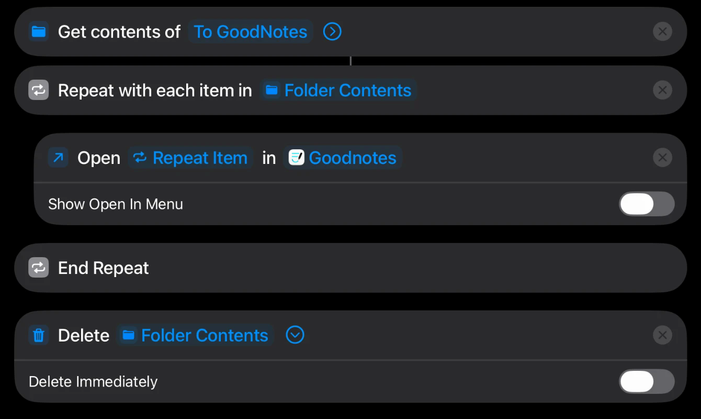

# moodle-sync

Downloads new course files from Moodle into an Obsidian vault twice a day and hands new PDFs to GoodNotes on the iPad. Python standard library only, no dependencies.

## How it works

1. **Access.** Moodle has a web-service API for its official mobile app. `login` uses the same sign-in handoff as the app: you log in through the normal university page (single sign-on works), and Moodle hands back a personal token. The script never sees your password, and the token only reaches courses you're enrolled in.
2. **Discover.** `core_enrol_get_users_courses` lists your courses; `core_course_get_contents` lists each course's sections and files with size and modification time.
3. **Decide.** A file is downloaded if it's new to `state.json` and not already in the module's `Materials/` folder (matched by name or byte size, so renamed copies are recognised). A file that changed on Moodle replaces the old copy.
4. **Deliver.** Files land in `Modules/<Module>/Materials/<Moodle section>/`. New PDFs are also copied to iCloud Drive › `To GoodNotes`. A Markdown note in the vault logs each run with wikilinks to the new files.
5. **Schedule.** A macOS `launchd` agent runs `sync` at 07:30 and 18:00. No server and no AI is involved in the daily runs.

```
Moodle API ──token──▶ moodle_sync.py ──▶ Obsidian vault (Modules/<Module>/Materials/)
                             │
                             └──▶ iCloud "To GoodNotes" ──iOS Shortcut──▶ GoodNotes (iPad)
```

## Setup

```bash
mkdir -p ~/moodle-sync/logs && cp moodle_sync.py config.example.json ~/moodle-sync/
cd ~/moodle-sync && mv config.example.json config.json   # set your Moodle URL
python3 moodle_sync.py login        # get a token (once)
python3 moodle_sync.py courses      # find course ids, map them in config.json
python3 moodle_sync.py sync --dry-run
python3 moodle_sync.py sync --no-goodnotes   # first run: don't flood GoodNotes
```

Schedule it: edit `local.moodle-sync.plist.example`, copy it to `~/Library/LaunchAgents/local.moodle-sync.plist`, then
`launchctl bootstrap gui/$(id -u) ~/Library/LaunchAgents/local.moodle-sync.plist`.

Your site has to allow mobile app access. If the official Moodle app works for your university, this will too.

## iPad: "Import to GoodNotes" Shortcut

GoodNotes has no API or watched import folder, so the last step is one tap:

1. **Get contents of** iCloud Drive › To GoodNotes
2. **Repeat with each item in** Folder Contents → **Open** Repeat Item **in** Goodnotes
3. **End Repeat** → **Delete** Folder Contents (*Delete Immediately* off, so files go to Recently Deleted)



## Try it without a Moodle account

`demo/fake_moodle.py` imitates the parts of Moodle's API the script uses, with three sample courses:

```bash
python3 demo/fake_moodle.py &                       # http://127.0.0.1:8765
printf '%032d\n' 0 > /tmp/demo-token
MOODLE_SYNC_TOKEN_FILE=/tmp/demo-token python3 moodle_sync.py sync --dry-run   # with "site" set to the fake server
```

## Design decisions

- **A scheduled script, not an AI agent.** Syncing is deterministic, so it runs for free and keeps working when no assistant is open. The AI assistant reads the results from the vault.
- **Token outside the vault.** `~/.config/moodle-sync/token` (mode 600) never lands in git, Dropbox or iCloud.
- **Only *new* files go to GoodNotes.** Re-importing an updated PDF would create a second document and strand the handwritten notes on the old one.
- **Atomic writes.** Downloads go to `.part` files and are renamed when complete; state is saved after every file, so an interrupted run resumes cleanly.
